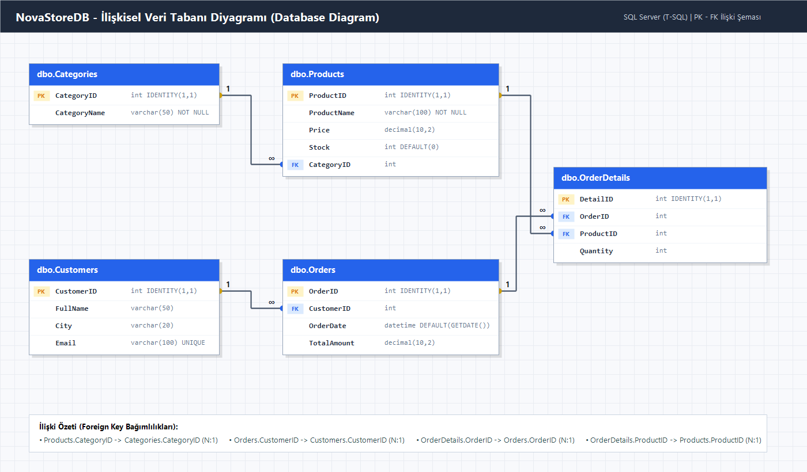

# NovaStore E-Ticaret Veri Yönetim Sistemi (`NovaStoreDB`)

Microsoft SQL Server (T-SQL) kullanılarak geliştirilmiş ilişkisel e-ticaret veri tabanı tasarımı, örnek veri seti, iş analizi sorguları, görünüm (View), yedekleme (Backup) ve performans/bütünlük geliştirmelerini içeren proje.

## Veri Tabanı Mimarisi

Sistem, 3. Normal Form (3NF) prensiplerine uygun olarak 5 ilişkisel tablo üzerine kurulmuştur:

- **`Categories`**: Ürün kategorilerini tutar (`CategoryID` PK, `CategoryName`).
- **`Customers`**: Müşteri bilgilerini ve benzersiz e-posta adreslerini tutar (`CustomerID` PK, `Email` UNIQUE).
- **`Products`**: Ürün detaylarını ve stok bilgilerini tutar (`ProductID` PK, `CategoryID` FK, `Stock` DEFAULT 0).
- **`Orders`**: Müşteri siparişlerini ve toplam tutarları tutar (`OrderID` PK, `CustomerID` FK, `OrderDate` DEFAULT GETDATE()).
- **`OrderDetails`**: Siparişler ile ürünler arasındaki çoka-çok (M:N) ilişkiyi çözen ara tablodur (`DetailID` PK, `OrderID` FK, `ProductID` FK, `Quantity`).

## Proje İçeriği

- **[FettahUskuplu_NovaStore_Proje.sql](FettahUskuplu_NovaStore_Proje.sql)**:
  - **Bölüm 1 (DDL):** `NovaStoreDB` veri tabanı ve 5 tablonun kısıtlamalarla oluşturulması.
  - **Bölüm 2 (DML):** 5 kategori, 12 ürün, 6 müşteri, 10 sipariş ve 16 sipariş detayı kaydı.
  - **Bölüm 3 (DQL):** Kritik stok listeleme, müşteri-sipariş birleştirme (`INNER JOIN`), müşteri bazlı ürün detay raporu (5 tablo `JOIN`), kategori ürün sayımı (`LEFT JOIN` & `GROUP BY`), ciro analizi (`SUM` & `ORDER BY`) ve sipariş zaman analizi (`DATEDIFF` & `GETDATE`).
  - **Bölüm 4 (View & Backup):** `vw_SiparisOzet` görünümü ve `C:\Yedek\NovaStoreDB.bak` tam yedekleme komutu.
  - **Ek Geliştirmeler:** Veri tutarlılığı için `CHECK` kısıtlamaları (`Price > 0`, `Stock >= 0`, `TotalAmount >= 0`, `Quantity > 0`) ve `JOIN` performansı için Foreign Key sütunlarında `NONCLUSTERED INDEX` tanımları.
- **[FettahUskuplu_NovaStore_Proje.png](FettahUskuplu_NovaStore_Proje.png)**: Tablolar arası PK/FK ilişkilerini gösteren veri tabanı diyagramı.
- **[FettahUskuplu_NovaStore_Proje.docx](FettahUskuplu_NovaStore_Proje.docx)**: Sorgu kodları, çalıştırma çıktıları ve teknik açıklamaları içeren proje raporu.

## Kurulum ve Çalıştırma

1. Bilgisayarınızda **Microsoft SQL Server** ve **SSMS (SQL Server Management Studio)** kurulu olduğundan emin olun.
2. Yedekleme komutunun (`BACKUP DATABASE`) hata vermemesi için `C:\Yedek` klasörünün mevcut olduğundan emin olun.
3. `FettahUskuplu_NovaStore_Proje.sql` dosyasını SSMS üzerinden açın ve **Execute (F5)** ile çalıştırın.
